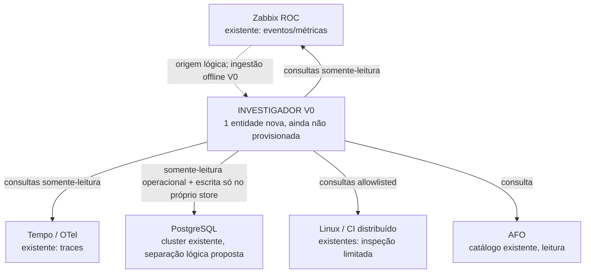
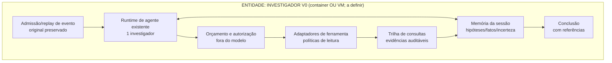

# Grafo de comunicação — Investigador Operacional V0

**Referência:** `AR-OPS-INV-V0@0.1.0-draft`  
**Estado:** PROPOSED, somente desenho; nenhuma alocação aplicada  
**Data:** 2026-10-15

## 1. Desenho das entidades de execução

Este desenho distingue **entidade de execução** (container/VM/serviço/host) de **módulo interno**. Ele não é um mapa de endereços ou configuração real.

No V0 offline, todas as setas que cruzam entidades são simuladas por fixtures. As linhas **não autorizam conexão real**.

## 2. O que fica dentro da nova entidade

**Memória de execução** e **histórico persistente** são conceitos distintos; o segundo está previsto para o próprio escopo lógico no PostgreSQL, sem criar uma segunda entidade PostgreSQL.

## 3. Matriz de fluxos e autoridade

| Origem | Destino | Quem inicia | Protocolo/porta | Necessário | Autorização | Zona/limite de confiança |
| --- | --- | --- | --- | --- | --- | --- |
| Fixture offline | Investigador | Runner de teste | In-process, sem rede | Sim no experimento | Dados sintéticos versionados | CI isolada |
| Investigador | Zabbix ROC | Investigador | API/porta **a verificar** | Somente em fase conectada | Identidade restrita a leitura de eventos/métricas | Observabilidade |
| Investigador | Tempo | Investigador | API de consulta/porta **a verificar** | Somente em fase conectada | Leitura e filtros obrigatórios | Observabilidade |
| Investigador | PostgreSQL: dados operacionais | Investigador | PostgreSQL/porta **a verificar** | Condicional à necessidade de consulta | Papel de leitura restrita/view | Dados operacionais |
| Investigador | PostgreSQL: store exclusivo | Investigador | PostgreSQL/porta **a verificar** | Sim em fase persistente; mock em CI | Papel próprio, escrita só no próprio namespace | Auditoria do investigador |
| Investigador | CI / Linux | Investigador via adaptador controlado | Endpoint/SSH restrito **a decidir** | Condicional | Comandos/operações allowlisted, sem sudo irrestrito | Plano operacional |
| Investigador | AFO | Investigador | Arquivos/API de leitura conforme origem, a definir | Sim para contexto quando disponível | Somente leitura | Repositório/registro governado |
| Investigador | Provedor do modelo | Runtime da entidade | HTTPS/porta e provedor **a verificar** | Dependente do runtime escolhido | Credencial exclusiva, egress controlado, conteúdo minimizado | Provedor externo / dados sensíveis |
| Zabbix | Investigador | Zabbix | **Não autorizado no V0** | Não | Event push/webhook fica para decisão posterior | Entrada operacional |

**Direções:** salvo decisão formal futura, a arquitetura privilegia consultas iniciadas pelo investigador. Não há reciprocidade implícita. A entrega ao investigador de evento real por push não é requisito do replay offline nem autorização para configurar o Zabbix.

## 4. Escolha de posicionamento

- **V0:** somente código/contrato/CI offline; **zero entidades novas implantadas**.
- **Candidata posterior:** uma entidade investigadora isolada (preferência inicial por container), ao lado de serviços existentes, sujeita ao grafo real e à menor conectividade possível.
- **L2 identity:** não demonstrada; não reservar.
- **L3 identity:** conectividade pode ser necessária, identidade dedicada não demonstrada.
- **Dedicated IP:** não requerido por este contrato.
- **Static IP:** não requerido por este contrato.
- **Networks attached:** nenhuma definida; decidir apenas após checar o grafo e o ambiente.
- **MikroTik:** configuração exclusiva do operador; nenhum script do investigador altera roteadores, firewalls ou bridges.
- **IPAM:** sem reserva de rede presumida, sem inventário privado em Git.

**Importante:** um novo Docker não implica nova rede. Reutilizar rede já permitida, DNS/identidade de serviço e controle de aplicação, se o levantamento autorizar. Um container multihomed exigiria justificativa independente e revisão de risco de trânsito não intencional.

## 5. Persistência PostgreSQL

Reutilizar **o mesmo cluster já existente**, desde que o levantamento prove capacidade e isolamento. Abrir namespace lógico exclusivo para investigação (preferencialmente database próprio, ou schema próprio quando os requisitos atuais o indicarem) e identidade de escrita **limitada ao armazenamento do investigador**.

Não conceder à identidade que consulta dados operacionais o direito de escrever nesses dados. Não realizar DDL/migrações operacionais nessa fase. Escolha database vs schema, backup/retenção, grants, migrador e disponibilidade ficam para contrato de persistência e CI validada.

## 6. Pré-condições antes de qualquer alocação real

1. Aprovar contrato de fluxo e modelo de confiança.
2. Comprovar endpoints, origens, protocolo, autenticação, porta e necessidade real — sem divulgar segredos ou endereços privados.
3. Validar negativas de acesso, isolamento de rede e restrições de consulta em testes controlados.
4. Definir provisionamento, rollback e observabilidade da entidade nova.
5. Obter autorização separada para AGT e, se necessário, operação de rede com o responsável pela MikroTik.

## 7. Desativação e rollback previstos

A futura entidade investigadora deverá poder ser desabilitada, desconectada ou removida sem interrupção de Zabbix, Tempo, PostgreSQL operacional, CI distribuído, Andy, AFO ou redes existentes. O histórico da investigação só será apagado mediante política explícita, nunca como efeito colateral de remover o container.

Referências: `docs/architecture/container-communication-network-placement-v1.md` e `docs/architecture/operational-investigator-v0-contract.md`.
