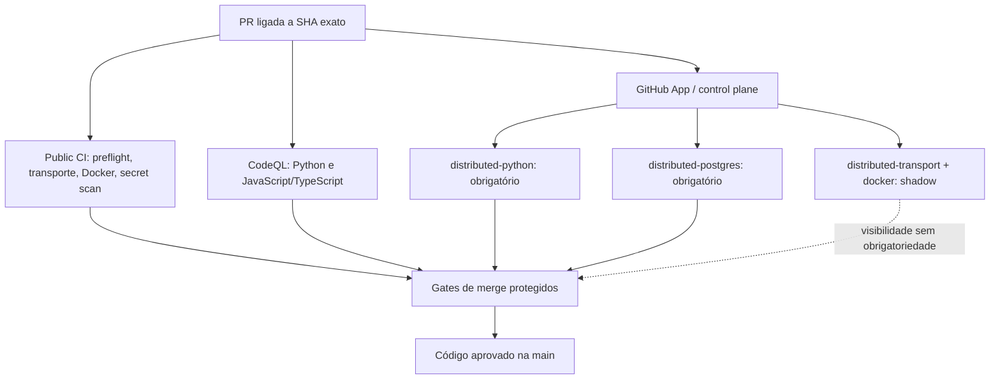

# Attention Router — engenharia verificável de CI

> Registro técnico de 12/10/2026. Os números abaixo referem-se a evidências
> identificadas, não a uma promessa de desempenho ou certificação de produção.

Não estamos mostrando apenas um agente de IA. A pergunta de engenharia é:
**como verificar que cada alteração respeita contratos, segurança, controle de
autoridade e operação em ambientes distintos?**

## Evidência acessível ao público

- **5 workflows versionados**, visíveis em [GitHub Actions](../.github/workflows/).
- **11 checks concluídos com sucesso**, em uma PR específica:
  [#313](https://github.com/escossio/attention-router/pull/313),
  no SHA candidato `704d340f86971b6e0367901510586ff49851f2fc`.
- **2 checks distribuídos obrigatórios**:
  `distributed-python` (suíte Python completa) e `distributed-postgres`.
- **2 checks distribuídos shadow**:
  `distributed-transport` e `distributed-docker`. São visíveis,
  mas ainda não substituem os gates públicos de transporte e Docker.
- **Benchmark histórico de 19/09/2026:** 403 testes PostgreSQL distribuídos
  entre três workers heterogêneos, de 286 s na referência inicial para ~103 s
  ponta a ponta. Ganho de tempo de ~64% e speedup de ~2,78× **naquele cenário**.

Cinco workflows não são onze pipelines. Um workflow pode produzir vários
jobs e checks; uma GitHub App pode publicar checks independentes. Cada número
acima tem origem e escopo próprios.

## Pipeline e fronteiras

A autoridade de merge depende das regras configuradas na branch, não da
quantidade total de badges verdes.

## Os cinco workflows

| Workflow | Responsabilidade |
| --- | --- |
| [Public CI](../.github/workflows/ci.yml) | Preflight Python/SDKs, transporte, builds e testes isolados de containers, varredura de segredos |
| [CodeQL](../.github/workflows/codeql.yml) | Análise estática Python e JavaScript/TypeScript |
| [CI Agent](../.github/workflows/ci-agent.yml) | Triagem e diagnóstico condicionado a falhas; proposta e persistência de correções sob gates e permissões separados |
| [Deploy Pages](../.github/workflows/pages.yml) | Montagem e publicação do site estático |
| [Publish container](../.github/workflows/publish-container.yml) | Release explícita `v0.1.0` com origem imutável, GHCR, SBOM e proveniência; não publica a cada commit |

O job hospedado `python-tests` faz preflight (lint, compilação e contratos):
**a suíte Python completa é executada pelo check distribuído obrigatório**.
A existência de automação para propostas de correção não significa que um
LLM tenha permissão ilimitada de alterar código.

## Laboratório distribuído: o que mudou

O [laboratório de CI](../ops/provisioning/distributed-ci-lab/README.md)
executa validações pesadas associadas ao SHA exato, usando worktrees
descartáveis e PostgreSQL sintético. A indisponibilidade de worker não deve
virar aprovação silenciosa.

O resultado de **2,78×** pertence ao **benchmark anterior**, com três workers
compartilhando testes PostgreSQL. A **política atual** fixa os testes PostgreSQL
em um worker designado, sem fallback automático; as suítes Python, transporte
e Docker possuem escalonamento próprio. Não é correto apresentar o benchmark
antigo como desempenho atual sem medição nova.

## Auditar em vez de acreditar

Consulte a [PR #313](https://github.com/escossio/attention-router/pull/313),
o [código dos workflows](../.github/workflows/),
a [documentação e metodologia do laboratório](../ops/provisioning/distributed-ci-lab/README.md),
o [modelo de ameaças](security/threat-model.md), as
[decisões arquiteturais](adr/README.md) e a
[demonstração executável do avaliador de autorização](authority-demo.md).

Limites: um check aprovado vale para seu commit e configuração; não prova
ausência de vulnerabilidades, prontidão de produção ou entrega externa real.

## English summary

Five versioned GitHub Actions workflows and eleven successful checks on
**PR #313** demonstrate separate public CI, CodeQL and exact-SHA distributed
validation. Full Python and PostgreSQL distributed checks are required;
distributed transport and Docker remain shadow. A **historical** three-worker
PostgreSQL benchmark measured ~2.78× end-to-end speedup. Current PostgreSQL
scheduling uses one designated worker, so the historical speedup must not be
presented as current performance. Review the sources and limitations above.
