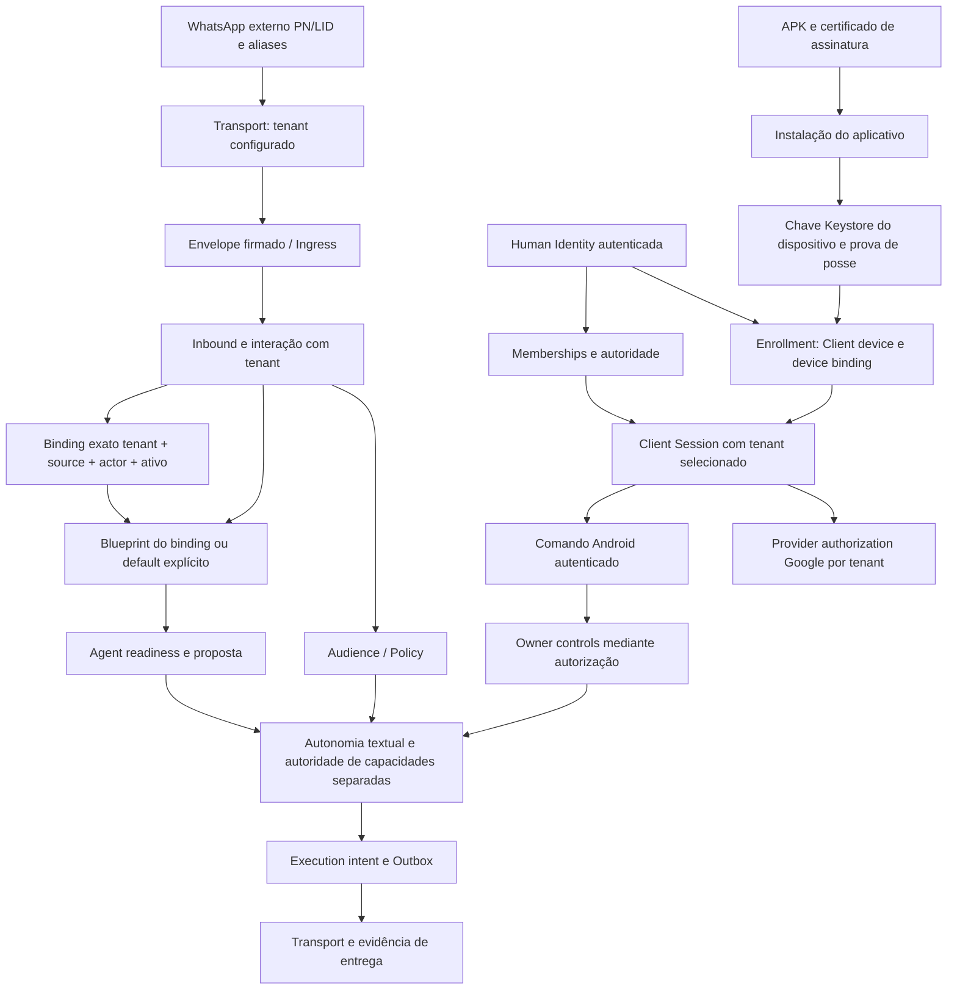

# Andy sem resposta — investigação causal #376

**Checkpoint de 18/10/2026 UTC.** Investigação e reprodução; recuperação produtiva
não executada. A [issue #376](https://github.com/escossio/attention-router/issues/376)
contém o ledger público. Evidências originais, índices e hashes ficam privados no
AGT; este relatório contém apenas agregados, código e horários.

## A. O que realmente aconteceu

Houve perda do caminho de atendimento **sem binding individual em setembro**,
seguida de recuperação parcial que ainda atendia um contato com binding em
outubro. A data do último envio geral retido e a data do último envio com binding
são marcos diferentes. Não foi demonstrada uma mudança de código em outubro
que tenha convertido esse mesmo fluxo funcional em bloqueio.

O Worker funcional de setembro carregava um blueprint padrão explicitamente
configurado. Na reconstrução operacional de 24–25/set, essa configuração não
foi preservada. O caminho com binding explícito continuou possível quando os
demais gates voltaram a permitir execução. O remetente do ensaio de 18/out
não tinha binding e o Worker continuava sem default: a primeira divergência
relevante é **a resolução do blueprint**, antes da chamada ao agente, da outbox
e do transporte. `CONVERSATION_BLUEPRINT_UNCONFIGURED` é a manifestação atual
dessa perda histórica; sozinho não teria demonstrado sua causa.

### Linha do tempo e confiança

| Marco UTC | Fortaleza (UTC−3) | Evidência e confiança |
| --- | --- | --- |
| 05/set 23:33:49 | 05/set 20:33:49 | **Confirmado:** `8743394` implementa conversa direta ampla por blueprint explícito/default; já contém `explicit_only=True`. |
| 06/set 00:24:06.073770 a 20/set 14:30:07.062532 | 05/set 21:24:06 a 20/set 11:30:07 | **Confirmado:** 50 respostas automáticas DONE, sete identificadores LID, sem binding individual, mesmo tenant. |
| 20/set 04:05:20 | 20/set 01:05:20 | **Confirmado:** criação do Worker `6611eac1`; inspect original registra 12 Compose files, default presente, execução/autonomia/entrega habilitadas. |
| 22/set 00:45:57.270837 | 21/set 21:45:57 | **Confirmado:** término desse Worker, exit137, `OOMKilled=false`, restart policy `no`. AFO-001 o relaciona ao shutdown; exit137 sozinho não demonstra OOM. |
| 24/set 16:40:14.699664 | 24/set 13:40:14 | **Confirmado:** substituto criado com Compose temporário único, default ausente e `AGENT_EXECUTION_ENABLED=false`; permaneceu `Created`. |
| 25/set, recuperação do consumidor | 25/set | **Confirmado pelo registro AFO-004; instante completo não determinado:** Worker volta a processar, sem paridade semântica do baseline. |
| 25/set 11:39:19.049023 | 25/set 08:39:19 | **Confirmado:** primeira auditoria retida `CONVERSATION_BLUEPRINT_UNCONFIGURED`; não é necessariamente a primeira falha ocorrida. |
| 26/set 02:10:56.055256 e 03:21:42.922876 | 25/set 23:10:56 e 26/set 00:21:42 | **Confirmado:** duas respostas DONE com binding explícito, ainda sem recuperação do caminho sem binding. |
| 03/out 04:05:48; 04:18:17; 04:41:49 | 03/out 01:05; 01:18; 01:41 | **Confirmado:** três DONE por Agent SDK, com binding/blueprint/policy. |
| 04/out 01:12:38; 02:33:51; 21:58:36 | 03/out 22:12; 23:33; 04/out 18:58 | **Confirmado:** três DONE pelo mesmo caminho. O primeiro é o último RESPOND com outbox DONE retido. |
| 05/out 15:01:15 | 05/out 12:01:15 | **Confirmado:** merge Android #67, mecanismo de troca de tenant; seletor nomeado de UI veio na #76 às16:26:25Z. Merge não prova instalação. |
| 05/out 15:02:41.330101 e 15:03:01.261616 | 05/out 12:02:41 e 12:03:01 | **Confirmado:** dois últimos DONE; decisões REQUEST_INFORMATION, não RESPOND. |
| 05/out 15:56:38.347304 | 05/out 12:56:38 | **Confirmado:** primeira decisão posterior sem saída, outro fluxo, non-direct com blueprint. Não estabelece transição causal do contato antes atendido. |
| 05/out 16:58:33.618360 | 05/out 13:58:33 | **Confirmado:** primeira decisão posterior sem blueprint no recorte; condição já existia em setembro. |
| 06/out 01:04:51 / 03:59 | 05/out 22:04:51 / 06/out 00:59 | **Confirmado:** merges Android #60 e #82 relativos à assinatura. |
| 06/out 14:19:32.547479 | 06/out 11:19:32 | **Confirmado:** novo client device; mesma Human Identity e memberships anteriores. |
| 06/out 23:31:04.326541 | 06/out 20:31:04 | **Confirmado:** SDK produz RESPOND, autonomia impede envio com SELF_MESSAGE. Não é falha do agente ou do transporte. |
| 07/out 06:13:28 | 07/out 03:13:28 | **Confirmado:** criação da API atual `d5a36d5`. |
| 07/out 22:36:37; 08/out 04:56:34 | 07/out 19:36; 08/out 01:56 | **Confirmado:** criação/start atual do Browser após containerização; não iniciou o bloqueio já retido desde25/set. |
| 15/out 00:44:00 | 14/out 21:44:00 | **Confirmado:** criação do Worker atual `4d06e4d`; Transport usa a mesma revisão. |
| 15/out 05:40:19 | 15/out 02:40:19 | **Confirmado:** primeiro PROBLEM AR-1001 retido; detector abriu um segundo antes. Não data a regressão. |
| 16/out 22:26:22.922935 | 16/out 19:26:22 | **Confirmado:** última decisão positiva SDK retida, REQUEST_INFORMATION, bloqueada legitimamente por SELF_MESSAGE. |
| 18/out 08:06:43 → 08:06:50 | 18/out 05:06:43 → 05:06:50 | **Confirmado:** ensaio antes da troca Android, sem blueprint/outbox. |
| 18/out 09:22:22 → 09:22:28 | 18/out 06:22:22 → 06:22:28 | **Confirmado:** ensaio após troca Android; mesmo tenant/actor/source, mesmo bloqueio. |

O registro AFO usa horário local em parte da cronologia. Este relatório corrige
explicitamente a equivalência: **21/set 21:45 Fortaleza é 22/set 00:45 UTC**.
A retirada exata do default entre dois instantes não foi registrada como evento
de configuração; o intervalo está delimitado por inspect funcional e substituto.

## B. Como a Andy funcionava anteriormente

O relato de atendimento a outros números ganhou prova independente: **50**
outboxes `agent_execution_text/voice` DONE ligadas por
`outbox.execution_intent_id → intent.agent_decision_id → decision.event_id`
a entradas `wwebjs`, lineage ORGANIC, EXTERNAL_INBOUND, `from_me=false`,
sete LIDs distintos, sem `actor_binding_id`. Esses sete identificadores não
provam sete pessoas únicas, pois aliases podem existir. Não provam universalidade.

Todos esses 50 registros selecionaram exatamente o blueprint apontado pelo
default do inspect antigo — igualdade verificada em memória, sem publicar IDs.
Todos registram `OPENAI_AGENTS_SDK`, autorização POLICY_AUTONOMY e DONE.
Portanto **não dependiam de cadastro individual nem de fallback legado**.

Os oito DONE de 03–05/out registram a mesma sequência:
`Agent SDK → RESPOND/REQUEST_INFORMATION → AUTO_ALLOWED → intent SENT/RELEASED
→ agent_execution_text → local_transport → DONE`, com binding explícito.
`DRY_RUN` em `agent_decisions.status` coexistia com execução autorizada em tabela
própria; esse status isolado não prova que nenhuma execução ocorreu.

Há 107 text DONE e 29 voice DONE no histórico disponível. Desses136,50 não
tinham binding e86 tinham. Um usou blueprint pessoal em15/ago; os outros135,
incluindo os oito de outubro, usaram blueprint published `food_service`.
No caminho SDK, `AllowedAgentContext` não recebe `agent_spec`: o domínio no
registro **não prova que o modelo respondeu como pizzaria**. O blueprint servia
à seleção/autonomia. Continua inadequado restaurar esse artefato como default
legítimo. AFO-008 comprova contaminação determinística em outro caminho,
non-direct/grupo, quando o ranking copia `missing_information` do canário.

DONE comprova conclusão no ledger de despacho; esta investigação não recuperou
ACK independente do provedor para cada envio. Os1.484 `dispatch_action/soft_ping`
DONE são processamento interno e não foram somados às respostas WhatsApp.
O banco tem entradas `wwebjs` desde08/ago; isso não demonstra retenção integral
de todo sistema legado ou de todos os dispositivos. Nenhuma conversa foi lida.

## C. O que mudou

### Primeira divergência funcional observada

| Propriedade | Geral histórico sem binding (50 DONE) | Vinculado03–05/out (8 DONE) | Teste18/out |
| --- | --- | --- | --- |
| Origem | wwebjs, ORGANIC, EXTERNAL_INBOUND | Mesma classificação | wwebjs externo |
| Tenant | Um tenant | Mesmo tenant do recorte histórico | Tenant do envelope; troca Android não o mudou |
| Binding | Ausente | Presente e ainda ativo | Ausente |
| Blueprint | Default explícito histórico | ID explícito do binding | Nenhum; default ausente |
| Policy | Selecionada, autonomia autorizada | Selecionada | Selecionada |
| Agent path | SDK executado | SDK executado | Não acionado por falta de blueprint |
| Decisão | RESPOND/REQUEST_INFORMATION | RESPOND/REQUEST_INFORMATION | INSUFFICIENT_CONTEXT |
| Autonomia | POLICY_AUTONOMY/AUTO_ALLOWED | POLICY_AUTONOMY/AUTO_ALLOWED | Sem resposta liberável |
| Outbox | DONE | DONE | Não criada |
| Entrega | Conclusão no ledger; ACK independente não reauditado | Mesmo limite | Nenhuma resposta produzida |

Ausência de resposta exigível, política de silêncio, SELF_MESSAGE, identidade
incompleta, falha de execução, falha de outbox e falha de entrega são estados
distintos. No ensaio atual a cadeia para antes de gerar resposta; não há uma
outbox presa no transporte que explique esse teste.

A mudança responsável pelo desaparecimento do atendimento sem binding foi
**a perda da configuração efetiva na reconstrução do Worker**. A prova primária
é o par de inspects privado, não um commit que apenas tocou arquivo relacionado.
AFO-004 já registrava esse drift; sua formalização versionada aparece em
`ae1b453cc921268aa17d9278b12b903b695b9f11` (30/set).

| Configuração | Worker funcional setembro | Substituto24/set | Worker18/out |
| --- | --- | --- | --- |
| Proveniência | 12 Compose files | um Compose temporário | overlays operacionais atuais |
| Default explícito | presente | ausente | ausente no settings efetivamente carregado |
| Execução do agente | true | false | true |
| Autonomia/entrega | true/true | true/true | true/true |
| Estado | respondeu, depois terminou | Created, nunca iniciou | healthy, consumidor ativo |

A desativação da execução era um segundo bloqueio histórico. Hoje os gates
`andy_agent_enabled`, `agent_execution_enabled`, `autonomous_execution_enabled`,
`external_delivery_enabled` e o pipeline estão true; legacy fallback está false.
Essa recuperação parcial explica por que um binding continuou respondendo.

Readiness local observada18/out09:52:16Z: READY/ANDY_AGENT_READY, sem provider
invocado. Ela verifica dependência/configuração/credencial presente, não quota,
disponibilidade do modelo remoto ou geração de resposta real.

O banco também preserva dois DONE vinculados em26/set e10 intents com
blocked_reason=AGENT_EXECUTION_DISABLED, com criação até03/out03:58:54Z.
Isso mostra recuperações/bloqueios parciais, não uma restauração monotônica de
todos os serviços. Criação do intent não data a avaliação do gate. O default
geral permanece a divergência independente comprovada no ensaio18/out.

Comparação semântica em cinco revisões: `6611eac1`, `b3a0c302`, `a17e2b84`,
`d5a36d5`, `4d06e4d`. As ASTs de `_blueprint`, `_agent_enabled_for` e
`direct_conversation_eligibility` são idênticas. Os bytes do pipeline e dos
arquivos direct/autonomy/execution/repository são idênticos entre o snapshot
05/out `a17e2b84`, API `d5a36d5` e Worker real `4d06e4d`; hashes do arquivo vivo
foram conferidos contra Git. O prefixo permite remetente sem binding **com**
default válido e bloqueia **sem** default em todas as revisões.

O diff posterior de services adiciona presença contextual de grupo; não remove
a outbox de conversa direta. `7c1055d` de05/set já proibia fallback após falha/hold
do agente. A identidade, policy, audience e tenant são resolvidos antes do
agente; nenhuma mudança semântica relevante nesse recorte explica o ensaio atual.
Contra setembro há outras evoluções de contexto/mídia/execução; a reprodução
delimita o prefixo demonstrado, sem declarar identidade de todo backend.

### Contratos de identidade e dependências



Seleção Android usa `OnboardingCoordinator.switchActiveTenant`; a seleção inicial
passa por `AndySessionViewModel.selectTenantForSession` e pelo coordinator.
Ela cria nova `client_session`; não altera `LOCAL_TENANT_ID` do Transport ou `actor_bindings`.
Ingress utiliza o tenant admitido no envelope; repository.resolve_actor_binding
exige correspondência exata e ativa. Aliases PN/LID permitem validar o canal de
retorno; não equivalem a autenticação de owner nem fundem bindings.

Existe acoplamento legítimo por **comando autenticado**:
`client_command._authority → owner_automation_controls/owner_operational_controls`.
Foram verificadas essas tabelas e o ledger: zero mudanças de controles entre
05–08/out. Respostas automáticas seguem habilitadas desde03/out04:44:58Z.
Não se encontrou acoplamento direto entre troca de sessão e tenant WhatsApp.

Android #67/#68/#76 e #60/#82 estão merged; #91 corrige loop201→409 em
multi-membership e está merged. **#93 continua OPEN/DRAFT**, embora relate
instalação de candidato; instalação relatada não é merge. A ativação06/out
preservou a pessoa e os memberships de setembro. Gmail mantém duas instalações
tenant-scoped da mesma identidade/conta; estado atual não prova cada handoff ou
revogação histórica. Reconexão Google não concede autoridade WhatsApp.

## D. Causa raiz: confirmada, provável e indeterminada

**Confirmada:** perda de paridade de configuração do Worker na reconstrução de
24–25/set, retirando o default que viabilizava conversa sem cadastro individual.
O contrato de código permanece; dados, inspects e contrafactual convergem no
mesmo primeiro bloqueio. O encerramento anterior do consumidor e o gate de
execução false foram causas independentes do apagão/recuperação parcial.

**Provável, com limite explícito:** a percepção de perda definitiva por volta da
reativação Android combina esse atendimento geral já perdido com o último
contato vinculado que ainda foi atendido05/out. Não há prova de que a
reativação causou qualquer uma dessas duas condições.

**Indeterminada:** o instante exato/comando que retirou cada override e eventual
atendimento fora do banco retido. Não há evidência de que o caminho com binding
tenha quebrado depois05/out: as duas entradas posteriores do mesmo ator são
`from_me=true`. A última decisão SDK16/out continua funcional até o bloqueio
SELF_MESSAGE. O ensaio18/out não compartilha LID exato com os136 DONE;
isso não exclui aliases históricos e não autoriza fundir identidades.

### Hipóteses testadas e como refutá-las

| Hipótese | Evidência positiva | Contrária / limite | Experimento discriminante |
| --- | --- | --- | --- |
| A: atendimento geral por outro caminho | Há manual/owner/legacy no histórico. | Os50 sem binding têm cadeia SDK/intent/outbox; não necessitam caminho alternativo. | Procurar outro ledger legado com prova de envio e provenance, sem importar/replay. |
| B: configuração mudou | Default presente→ausente; execution true→false em inspects. | Defaults antigos eram canário; não aprovam restauração cega. | Mesma fixture e revisão, alterando só default aprovado; caminho do agente muda. |
| C: roteamento Android/Ingress | Seletor, reativação e Gmail têm cronologia próxima. | Tenant/actor/source iguais nos dois ensaios; perda precede Android; controles sem alterações. | Fixture Android com duas sessões e mesmo envelope WA deve preservar tenant/binding. |
| D: contexto ficou restritivo | Ausência de blueprint interrompe o fluxo atual. | Gate explícito existe desde05/set; oito bindings preservados responderam em outubro. | Comparação cross-revision já reproduz mesmo gate; eventual outro campo exige fixture nova. |
| E: responder difere de executar tarefa | Contrato direct só concede respond/request_information; capabilities têm autoridade separada. | Não certifica que todo texto/prompt respeite privacidade sem testes do candidato. | Visitor pode responder; mesma identidade deve ser negada para admin/Gmail. |
| F: fallback deixou de ser chamado | Branches legacy/behavior existem. | Proteção após falha existe desde05/set;50 entregas reais usam SDK. | Mesma fixture com default ausente não deve criar fallback externo. |
| G: histórico incompleto | Não há prova de retenção universal/aliases de pessoas. | Banco preserva50 respostas sem binding; relato não pode ser descartado por oito casos de outubro. | Auditar apenas índices/ledgers legados disponíveis; requerer ACK quando alegar entrega externa independente. |

## E. Por que não detectamos imediatamente

AFO-002/004 já distinguiam consumidor parado de processo healthy com gates
diferentes. Não havia manifesto canônico que garantisse paridade dos12 overlays
na recriação. Docker, ICMP, HTTP200 e Ingress processado não verificavam a função
de atendimento a um visitante sem binding.

AR-1001 foi observado em PROBLEM15/out05:40:19Z, um alerta enviado, zero recovery.
Sua sonda agrega janela6h e persiste o incidente até um DONE posterior à abertura
e última falha. O alarme **detectou sintoma**, não mudança de configuração nem
expectativa individual de resposta. `blueprint_6h` conta conversation.blocked;
categorias sobrepostas não são mensagens distintas. Quinze itens atuais são
operacionais, mas não tornam o diagnóstico causal automaticamente disponível.

As PRs [#375](https://github.com/escossio/attention-router/pull/375),
[#377](https://github.com/escossio/attention-router/pull/377),
[#378](https://github.com/escossio/attention-router/pull/378) e
[#379](https://github.com/escossio/attention-router/pull/379) estão OPEN/DRAFT,
sem merge. A sonda/ficha MGMT tiveram ativações isoladas registradas; não é
correto atribuir tudo à main. MAESTRO/Relay preservam transporte de ocorrência,
sem significar que investigaram sua causa.

Seis PCAPs e oito logs da captura já existente tiveram14/14 hashes revalidados.
Foram reaproveitados índices/relatório, sem nova captura nem publicação de bruto.
Tráfego em seis namespaces e48 traces na janela não prova trace causal do teste.
Correlação de entrada e de auditoria não é automaticamente a mesma operação;
`_audit` pode gravar correlation_id=None. Causa por trace continua **NOT_PROVEN**;
consulta historicamente bloqueada não foi contornada. Essa lacuna prejudica
rastreabilidade, mas não removeu o blueprint.

## F. Correção mínima e prevenção

Não foi demonstrado defeito novo em `_blueprint` que justifique relaxá-la.
A recuperação mínima é **restabelecer configuração declarativa aprovada de
atendimento geral**, com blueprint/versionamento de domínio apropriado, autoridade
textual limitada e default explícito no Worker. Não cadastrar apenas o número de
teste; não usar food_service; não promover silenciosamente o pessoal draft/observe.

O procedimento exato, gates, snapshot e rollback estão no
[plano de recuperação](andy-resurrection-recovery-gate-20261018.md).
A disponibilidade de um default não basta: o blueprint pessoal atual é observe,
portanto apenas apontar para ele não comprova execução automática.

Nesta PR: relatório, SQL manual somente leitura, reprodução sintética, pacote
integral de recuperação **proposto**, preflight puro e regressões do candidato.
Nenhum arquivo de configuração operacional foi tocado. O pacote está em
[andy_visitor_recovery.proposed.json](../../config/examples/andy_visitor_recovery.proposed.json).
O preflight não publica, autentica aprovação ou muda o selector.

O default também participa da seleção em non-direct/grupos e bindings sem ID,
inclusive owner. Seu alcance não é exclusivo de visitantes. O candidato reconhece
esse impacto e a eventual alteração da policy unknown; o teste de grupo comprova
seleção diferente sem autorizar efeito automático. Binding com ID explícito
continua tendo precedência. A policy proposta torna explícitas as duas ações
textuais, mantendo capabilities e disclosures vazios.

Prevenção proposta para o processo existente: materializar gates e proveniência
no artefato de deploy, comparar contra baseline aprovado antes de substituir
Worker, e executar fixture de visitante sem binding no mesmo SHA. Detector
funcional deve distinguir nenhuma resposta exigível, contexto ausente, negação
autorizada, falha do agente, outbox e entrega; alterar Zabbix exige incremento
próprio, sem modificar Relay/MAESTRO nesta missão.

## G. Impacto de segurança

A reprodução não concede owner: owner_authenticated permanece false;
tenant divergente e versão de outro blueprint impedem seleção.
O contrato direct é respond/request_information; tarefas, Gmail, disclosures e
administração exigem autoridades independentes. O lookup exato não é substituído
por comparação de nome, telefone ou alias.

**Limite encontrado:** o selector isolado não valida domínio nem status draft.
Seu sucesso não é certificado de adequação ou publicação. A aprovação e o
preflight do candidato devem rejeitar domínio incompatível, versão inválida e
artefato em observe. Os17 cenários completos não podem ser substituídos por70
asserções do prefixo. Foram preparados no pipeline real com candidato sintético;
permanecem distintos da certificação do provedor e da aprovação operacional.
Esta PR não afirma uma restauração produtiva existente.

## H. Certificação e matriz de regressão

Reprodução efetiva:14 casos por revisão ×5 revisões = **70 PASS**, com ASTs
idênticas no prefixo. Quatro testes do harness incluem mutação que retira a
dependência de blueprint e é detectada como falha. O prefixo usa Session.get,
readiness e settings sintéticos; não é ensaio E2E.

```bash
python scripts/forensics/andy_reply_counterfactual.py \
  6611eac16b2e6cf6f4d7bd1fb2cfdca627d8b5f3 \
  b3a0c3023ce376a7549ec1674cb8829610a92332 \
  a17e2b84bb70521b02f849d06027f334130e5128 \
  d5a36d5c2264a3b2c4ad77a416aa1ee4bd4a8ec7 \
  4d06e4d4545ac4720b0ed8148a63653d3132e566
```

`tests/test_andy_visitor_recovery.py` executa os17 cenários e um caso adicional
de grupo:18 casos SQLite. O wrapper
`tests/integration/test_postgres_andy_visitor_recovery.py` reutiliza os17 casos
com persistência na fixture vigente de banco aleatório migrado e limpo entre
testes; o preflight de domínio é puro. Esses17 casos executam no worker,
nunca no AGT. Quinze testes do preflight incluem mutantes de domínio, publicação,
autoridade, tenant, versão, ações e reconhecimento do alcance.

Execução consolidada curta: **41 PASS em5,86s**. Inclui
4 testes do contrafactual,18 do candidato,15 do preflight e4 contratos integrados
existentes. Agent e Transport são fake; pipeline, policy, autonomia, intent e
outbox são reais em fixtures. Ruff e diff-check passaram. O SQL agregado foi
executado em READ ONLY com timeout3s;21 linhas, sem conteúdo/identificadores.

A primeira execução de quatro contratos antigos isolados falhou antes das
asserções por import de modelo HumanIdentity na fixture. Registrar os modelos
como na coleta completa resolveu; a aplicação não mudou. Um helper novo de
graça foi corrigido para anchor_interaction_id após falha do teste, e uma rodada
cruzou edição concorrente do manifesto; a execução consolidada acima usa todos
os arquivos estáveis. Não se atribuiu nenhuma dessas falhas ao runtime.

O preflight certifica forma/checksum da proposta. Seus booleans de tenant e
versão são **CALLER_ASSERTIONS_ONLY**: não autenticam um operador nem demonstram
existência de linhas produtivas. Checksum do pacote proposto:
`c22cdaef3702407f2236614db9652a440e93a8c725f2e758b9fe3cbccb5443df`.

O primeiro SHA publicado81f4231 tinha variantes PG fora da descoberta instalada,
que aceita apenas tests/integration/test_postgres*.py. A inspeção do manifesto do
worker identificou a lacuna antes da certificação. O wrapper acima corrige o
ponto de entrada sem duplicar cenários. PASS do SHA81 não certifica os17 casos.

Resultados dos checks distribuídos e SHA final ficam na
[PR #380](https://github.com/escossio/attention-router/pull/380) e no
comentário de certificação da issue376. PostgreSQL completo usa CI03; os17
casos do wrapper integram a descoberta desse gate. Python/Docker/Transport usam
fluxo distribuído existente; architecture guard está dentro de docker-build.
O ruleset exige distributed-python além dos checks legados. Nenhum resultado de
SHA anterior certifica HEAD novo. Não houve suite pesada no AGT.

Uma falha independente no gate Transport foi reproduzida:272 testes Transport e
64 de conformidade passaram; o teste do SDK TypeScript assumia array no JSON
de npm pack e falhou no formato keyed-object. Foi reaproveitado, sem reconstruir,
o commit `7d412ff40933dd239cb091dd34ef9de9ad37453f` da PR #360, ainda draft.
O ajuste preserva as asserções de arquivos, valida um único pacote e testa os
dois formatos. Altera apenas sdks/typescript/tests/installed-package.mjs, sem
mudança no SDK publicado ou runtime. Os checks antigos dessa PR não certificam
o novo SHA; o gate completo deve passar novamente. Essa falha não explica o
incidente WhatsApp e permanece separada da causalidade acima.

| # | Cenário exigido | Prova offline do candidato e limite |
| --- | --- | --- |
| 1 | Visitante novo, pergunta simples | Pipeline→autonomia→outbox→DONE no adapter fake, sem binding criado. |
| 2 | Binding ativo | Blueprint explícito do binding prevalece sobre default do candidato. |
| 3 | Binding inativo | Visitante não herda owner/metadata/disclosures do vínculo inativo. |
| 4 | LID distinto do PN | Alias de retorno válido; binding PN de owner não autentica LID como owner. |
| 5 | Tenant divergente | Divergência tardia do inbound impede intent ir à outbox. |
| 6 | Blueprint sem versão válida | Pipeline não chama Agent; nenhum intent. Harness cobre também versão estrangeira/ausente. |
| 7 | Blueprint de outro tenant | Pipeline não chama Agent nem libera execução. |
| 8 | Domínio incompatível | Preflight rejeita food_service; selector continua sem validar domínio. Não há novo bloqueio runtime. |
| 9 | Pergunta sem ferramentas | Zero requested_capabilities/grants; contexto privado vazio. |
| 10 | Comando admin externo | Proposta hostil de grant.create recebe POLICY_DENIED; executor owner nunca chamado. |
| 11 | Gmail solicitado por terceiro | gmail.read recebe UNKNOWN_CAPABILITY, sem executor; não há capacidade Gmail nesse registry. Não certifica conector Gmail autorizado. |
| 12 | Política de silêncio/recusa | Policy OBSERVE vence proposta de resposta; nenhum intent. Recusa textual segura nos casos10/11. |
| 13 | Resposta gerada/outbox indisponível | Falha injetada de persistência, rollback preserva intent, zero adapter; retry gera uma outbox. |
| 14 | Outbox disponível/Transport offline | Adapter fake falha; resultado ambíguo não é DONE nem repetido cegamente. |
| 15 | Duplicata/replay | Mesmo inbound, uma decisão, um intent, uma outbox e uma chamada fake. |
| 16 | Tracing indisponível | Tracer falha; função chega a DONE no adapter fake. |
| 17 | Identidade parcial | Conversation AMBIGUOUS impede Agent/intent/outbox, owner_authenticated continua false. |

Caso18 adicional: grupo pode selecionar o default, mas não chama Agent nem cria
intent automático. A tabela descreve testes executados em fixtures, sem alegar
LLM real, ACK WhatsApp ou restauração produtiva. PostgreSQL e checks oficiais do
SHA permanecem no ledger de certificação da PR.

## I. Estado operacional e continuidade

Produção preservada: nenhuma escrita de identidade/binding/tenant, promoção de
blueprint, execução externa, restart, troca de imagem, alteração de controles,
Zabbix, Relay, MAESTRO, Gmail, rede ou autorização Google nesta investigação.
O problema permanece aberto; não houve recuperação artificial nem mensagem de
teste gerada pelo investigador.

Checkpoint privado durável inclui notas por frente, hashes de inspects/PCAP/logs,
resultado cross-revisions e próxima ação. STATUS.md da branch foi atualizado.
História foi apenas consultada: sem importar/replay, alterar cursor ou memória.
Live continuity continua no caminho atual; aceleração histórica foi avaliada
como evidência forense e não como ingestão funcional neste incremento.

## J. Próxima decisão do operador

Aprovar o candidato de atendimento textual limitado e seu procedimento de
promoção **somente depois dos gates do plano de recuperação**. A autorização
precisa abranger novo blueprint/versão, autonomia textual e default explícito;
o mandato desta missão proíbe presumir essa escrita operacional.

Até essa decisão, a entrega é diagnóstico causal reproduzível e recuperação
preparada. Não é correto declarar a Andy recuperada, cadastrar uma exceção ou
atribuir a interrupção geral à atualização Android.
